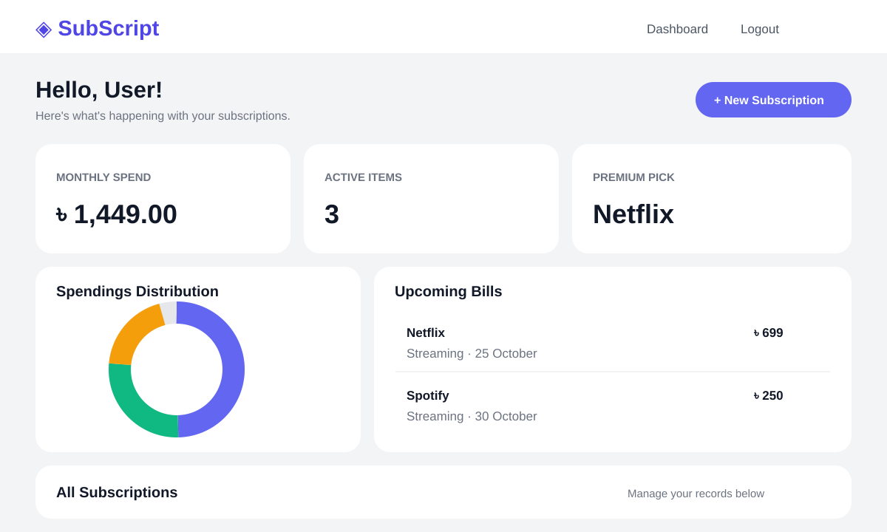

# SubScript Pro

Keep subscriptions, upcoming bills, and spending in one place.

[**Open the live app**](https://subscript-pro-4suq.onrender.com) · [View the source](https://github.com/Nazmul142965/SubScript)



> The image above is an illustration based on the dashboard UI. It is not a screenshot of live account data.

## What it does

- Add, edit, and delete subscriptions with a service name, amount, category, next billing date, notes, and active status.
- See total active subscription spending, category spending, and the highest priced subscription on the dashboard.
- Review upcoming billing dates in a timeline.
- Register and sign in with an email and password. Admin accounts can view users and block or restore accounts.

Amounts are displayed in Bangladeshi taka (৳). The dashboard's “Monthly Spend” total sums active records; it does not convert different billing intervals to a monthly equivalent.

## Built with

Java 21 · Spring Boot · Spring MVC · Spring Security · Spring Data JPA · Thymeleaf · MySQL · Bootstrap 5 · Chart.js

## Run locally

You need **Java 21** and a running **MySQL** server. Create an empty database, then set these environment variables to your JDBC connection details:

| Variable | Example |
| --- | --- |
| `DB_URL` | `jdbc:mysql://localhost:3306/subscript` |
| `DB_USER` | `root` |
| `DB_PASS` | Your MySQL password |

In PowerShell:

```powershell
$env:DB_URL = "jdbc:mysql://localhost:3306/subscript"
$env:DB_USER = "root"
$env:DB_PASS = "your-password"
.\mvnw.cmd spring-boot:run
```

Open [http://localhost:8080](http://localhost:8080) and register an account. On macOS or Linux, use `./mvnw spring-boot:run` after setting the same environment variables.

## Docker

The included Dockerfile builds and runs the app on port `8080`. Pass `DB_URL`, `DB_USER`, and `DB_PASS` to the container, and use a database hostname reachable **from the container**.

```bash
docker build -t subscript-pro .
docker run --rm -p 8080:8080 \
  -e DB_URL="jdbc:mysql://host.docker.internal:3306/subscript" \
  -e DB_USER="root" \
  -e DB_PASS="your-password" \
  subscript-pro
```

The example hostname works with Docker Desktop; other Docker setups may need a different database hostname.

## Project layout

```text
src/main/java/com/patu/subscripts/
├── config/       Spring Security configuration
├── controller/   Web routes
├── model/        User and subscription entities
├── repository/   Database access
└── services/     Business logic
src/main/resources/templates/   Thymeleaf pages
```
